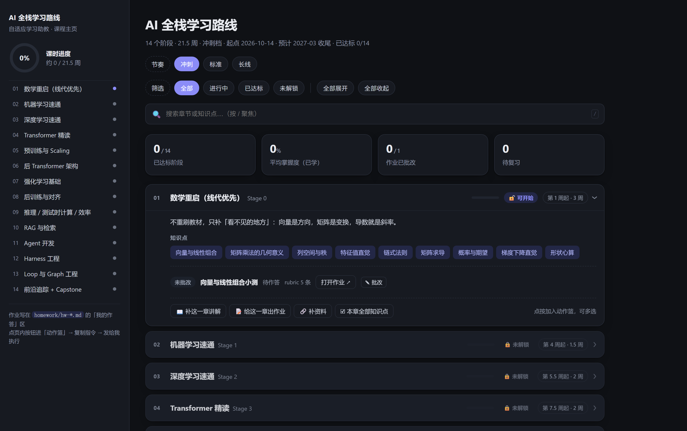
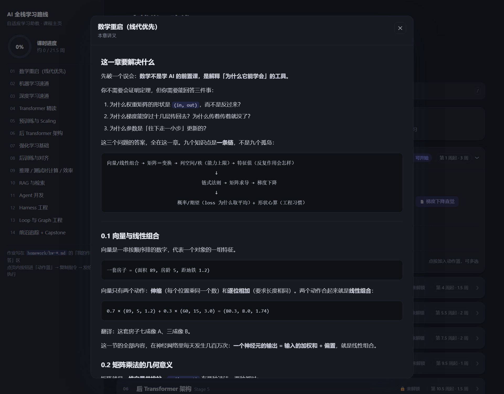

# Alamo Skill Hub

[](LICENSE)
[](#what-is-in-here)
[](#four-things-they-share)

**English** | [简体中文](README.zh-CN.md)

Four installable agent skills. Not prompt collections — each package ships a written manual, deterministic scripts that do the mechanical work, and an explicit statement of what it cannot do.

They solve four unrelated problems: Python memory blowing up, a repository that needs committing and pushing correctly, engineering work that should be delegated, and a learning goal that has to become a course that actually runs.

## What Is In Here

| Package | Installs as | Solves | Entry point |
|:--|:--|:--|:--|
| [`memory_hotspot_repair_kernel`](packages/memory_hotspot_repair_kernel/) | 4 skills | Python memory hotspots: find, fix, validate, review, stop | `$memory-optimizer-agent` |
| [`github_sync_workflow_kernel`](packages/github_sync_workflow_kernel/) | 1 skill | Finding the real repo, checking auth, scoping the commit, pushing, verifying | `$github-sync-agent` |
| [`engineering_subagent_workflow_kernel`](packages/engineering_subagent_workflow_kernel/) | 5 skills | Exploration, architecture, review, simplification, test-gap analysis via host subagents | `$code-explorer` and siblings |
| [`coursecoach`](packages/coursecoach/) | 1 skill | Turning a learning goal into a runnable course | `/coursecoach` |

All four are Apache-2.0, pure Python 3.8+ standard library plus `pyyaml`, and carry no backend.

## Four Things They Share

**1. A manual plus scripts, not a prompt.** Every package has a `SKILL.md` or `README.md` that states the rules, and a `scripts/` directory that performs the mechanical steps. The model decides *what*; the script decides *where it goes*. This is why the output is repeatable across sessions and models.

**2. One writer per piece of state.** In `coursecoach` only `grade.py` may write a score. In `memory_hotspot_repair_kernel` the loop is driven by `orchestrate.py`, not by the model's sense of when to stop. A second writer is how state starts disagreeing with itself.

**3. Bounded by construction.** The memory loop is capped at 2 rounds (3 only if asked). The GitHub workflow ends at a verified remote state. Spaced review uses fixed 1/3/7/16/35/75-day intervals. None of these run until "good enough" — they stop at a declared point.

**4. Portable, and honest about it.** Each package carries `PORTABLE_USAGE.md` and `metadata.json`, names the hosts it targets, and states what degrades on a host that lacks a capability. No package silently assumes Codex.

## The Packages

### memory_hotspot_repair_kernel

For Python services whose RSS keeps climbing, batch jobs that spike during joins or model scoring, and pipelines where "chunking" still loads the whole dataset.

Four coordinated skills: `memory-check` inspects and ranks hotspots, `memory-fix` remediates the highest-value one, `memory-review` reviews the change independently, and `memory-optimizer-agent` orchestrates all four into one bounded loop with explicit stop conditions. The other three also run standalone.

Read: [package README](packages/memory_hotspot_repair_kernel/README.md) · [long-form wiki](packages/memory_hotspot_repair_kernel/wiki/memory-skill-suite-wiki.md) · [portable usage](packages/memory_hotspot_repair_kernel/PORTABLE_USAGE.md)

```bash
cd packages/memory_hotspot_repair_kernel
python3 scripts/sync_to_codex_home.py
```

### github_sync_workflow_kernel

For the step everyone gets wrong once: deciding which directory is the real repository, whether the remote and auth are actually working, which changes belong in this commit and which are line-ending noise, and whether the push landed.

`github-sync-agent` runs repository discovery, auth and remote inspection, commit-scope review, commit, push, and post-push verification as one workflow. The wiki documents the failure modes it was built against.

Read: [package README](packages/github_sync_workflow_kernel/README.md) · [wiki](packages/github_sync_workflow_kernel/wiki/github-sync-workflow-wiki.md) · [portable usage](packages/github_sync_workflow_kernel/PORTABLE_USAGE.md)

```bash
cd packages/github_sync_workflow_kernel
python3 scripts/sync_to_codex_home.py
```

### engineering_subagent_workflow_kernel

Five development skills that delegate through the host's own subagent mechanism instead of an external runner binary: `code-explorer`, `code-architect`, `code-reviewer`, `code-simplifier`, `pr-test-analyzer`.

Each skill is self-contained — its role reference ships with it. It does not install helper binaries, spawn nested agent processes, choose a model, or weaken the host's approval and sandbox policy. Hosts without native subagents fall back to in-session execution and report `fallback_in_session` so the difference is visible.

Read: [package README](packages/engineering_subagent_workflow_kernel/README.md) · [portable usage](packages/engineering_subagent_workflow_kernel/PORTABLE_USAGE.md)

```bash
cd packages/engineering_subagent_workflow_kernel
python3 scripts/sync_to_codex_home.py --dry-run
python3 scripts/sync_to_codex_home.py
```

### coursecoach

The odd one out — it is not about code. Give it a topic and a daily time budget and it produces a course that runs: a dependency-ordered syllabus, a compiled interactive board you double-click, written lessons, gradable homework, mastery-gated unlocking, spaced review, and a periodic frontier pass that keeps the syllabus from going stale.

The syllabus is the only source of truth. The board is a build artifact and is never hand-edited. Only `grade.py` may write a score, so every grade stays traceable to a rubric line and a physical location in the file. A course is a folder: copy it to duplicate, zip it to share.





Read: [package README](packages/coursecoach/README.md) · [中文说明](packages/coursecoach/README.zh-CN.md) · [install and 15-minute trial](packages/coursecoach/INSTALL.zh-CN.md) · [portable usage](packages/coursecoach/PORTABLE_USAGE.md)

```bash
cp -r packages/coursecoach/coursecoach ~/.workbuddy/skills/coursecoach
pip install pyyaml
```

## Pick Your Starting Point

| You want to | Install | Then say |
|:--|:--|:--|
| Stop a Python job from OOM-ing | `memory_hotspot_repair_kernel` | `Use $memory-optimizer-agent to optimize memory hotspots in the current codebase.` |
| Commit and push without guessing | `github_sync_workflow_kernel` | `Use $github-sync-agent to sync this repository.` |
| Hand a broad task to a subagent | `engineering_subagent_workflow_kernel` | `Use $code-explorer to trace how feature X is wired.` |
| Learn something properly | `coursecoach` | `I want to learn X, one hour a day.` |

## Install

### Codex

```bash
git clone https://github.com/Alamoooooooo/alamo_skillhub.git
cd alamo_skillhub/packages/memory_hotspot_repair_kernel
python3 scripts/sync_to_codex_home.py
```

`sync_to_codex_home.py` copies into `$CODEX_HOME/skills`, or `~/.codex/skills` when `CODEX_HOME` is unset. Add `--dry-run` to preview. The three kernel packages each have their own copy of this script; install only the ones you want.

### WorkBuddy, CodeBuddy, Claude Code, or any host that reads `SKILL.md`

```bash
git clone https://github.com/Alamoooooooo/alamo_skillhub.git
cp -r alamo_skillhub/packages/coursecoach/coursecoach ~/.workbuddy/skills/coursecoach
```

The installable unit is always the directory that contains `SKILL.md` — `coursecoach/coursecoach/`, `memory-optimizer-agent/`, `github-sync-agent/`, and so on. `pip install pyyaml` is required by `coursecoach`; `export.py --format docx` additionally needs `python-docx`.

For hosts that understand neither skill installation nor `$name` tokens, read the relevant `PORTABLE_USAGE.md`: it explains how to feed the manual and run the scripts by hand.

## Repository Layout

```text
alamo_skillhub/
├── README.md                          English (this file)
├── README.zh-CN.md                    简体中文
├── AGENTS.md                          conventions for agents working on this repo itself
├── llms.txt                           machine-readable summary for AI crawlers
├── TODO_codex_plugin_marketplace.md   unfinished plan to ship these as a Codex plugin
├── LICENSE                            Apache-2.0
├── packages/                          ← the products
│   ├── memory_hotspot_repair_kernel/
│   │   ├── memory-optimizer-agent/    orchestrator (primary entry point)
│   │   ├── memory-check/  memory-fix/  memory-review/
│   │   ├── references/  scripts/  wiki/
│   │   └── README.md  PORTABLE_USAGE.md  metadata.json
│   ├── github_sync_workflow_kernel/
│   │   ├── github-sync-agent/
│   │   ├── scripts/  wiki/
│   │   └── README.md  PORTABLE_USAGE.md  metadata.json
│   ├── engineering_subagent_workflow_kernel/
│   │   ├── code-explorer/  code-architect/  code-reviewer/
│   │   ├── code-simplifier/  pr-test-analyzer/
│   │   ├── scripts/
│   │   └── README.md  PORTABLE_USAGE.md  metadata.json
│   └── coursecoach/
│       ├── coursecoach/               the skill itself (SKILL.md, references, scripts, examples)
│       ├── docs/                      board.png, lesson-reader.png
│       └── README.md  README.zh-CN.md  PORTABLE_USAGE.md  INSTALL.zh-CN.md  metadata.json
└── examples/                          ← optional, never required to install
    └── memory_hotspot_repair_kernel/
        └── partitioned_batch_pipeline/    one repo-specific adaptation: overlays + run configs
```

`packages/` is the product. `examples/` shows one adaptation of the generic memory package to a specific repository — useful when you write your own overlays, irrelevant if you do not.

## Other Files

| File | What it is |
|:--|:--|
| `AGENTS.md` | Rules for an AI agent working *on this repository*: how to distinguish packages from examples, how to update docs and install paths. Not part of any product. |
| `llms.txt` | A flat summary of all four packages for AI crawlers and search. Same content as this README, optimised for machine reading. |
| `TODO_codex_plugin_marketplace.md` | An unimplemented plan to package the memory suite for the Codex plugin marketplace. Kept for reference; nothing here depends on it. |
| `metadata.json` (per package) | Machine-readable descriptor: entry point, keywords, supported hosts, script list. |

## License

Apache-2.0. See [LICENSE](LICENSE).
