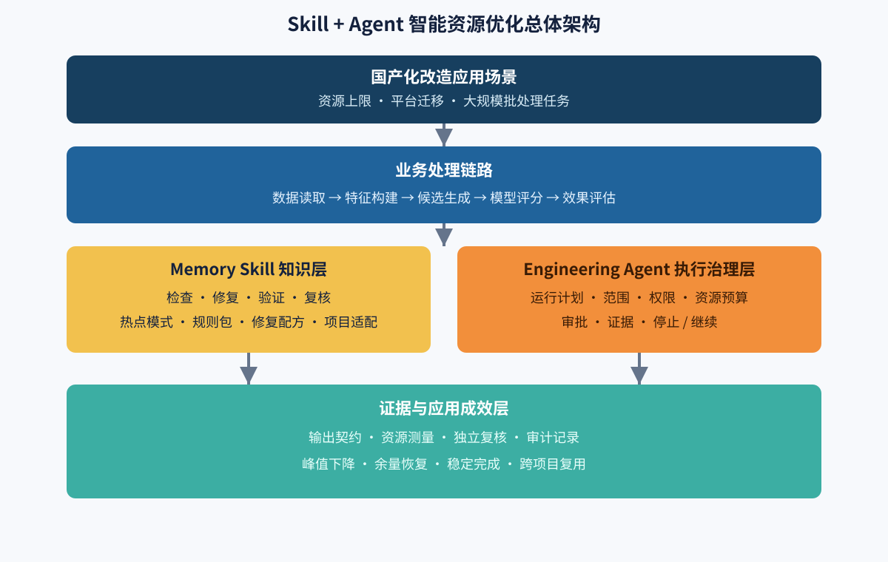
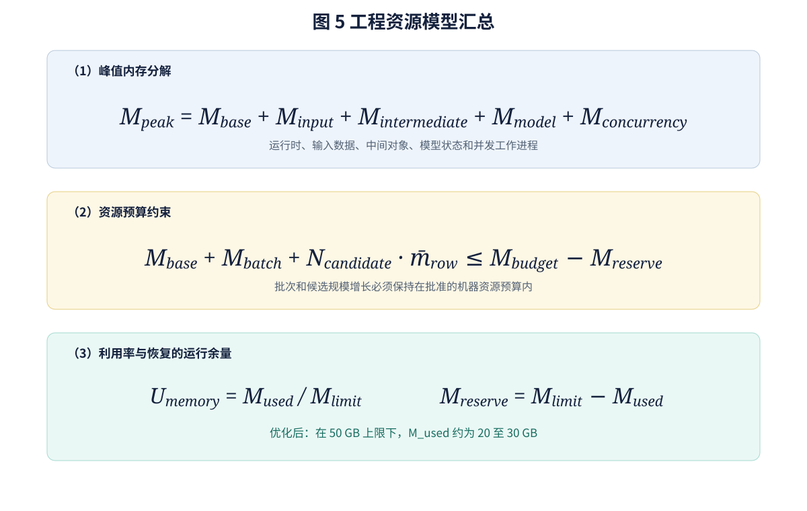
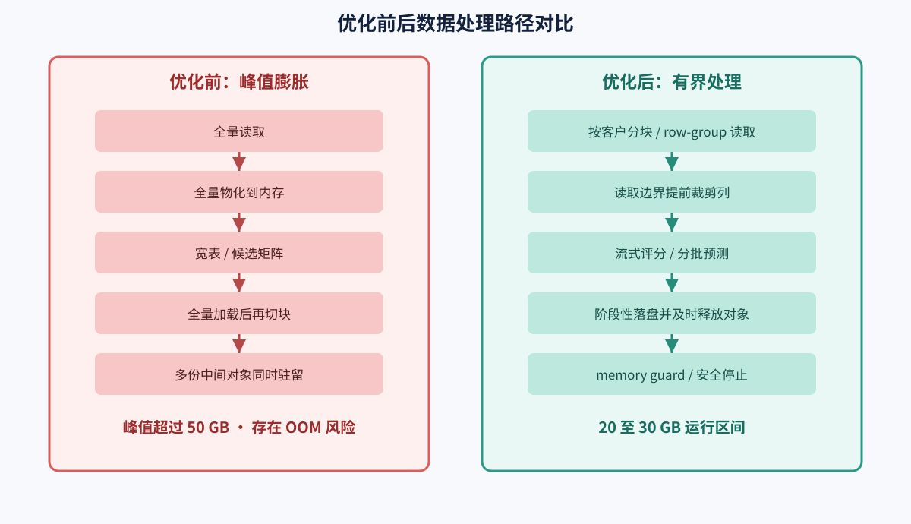
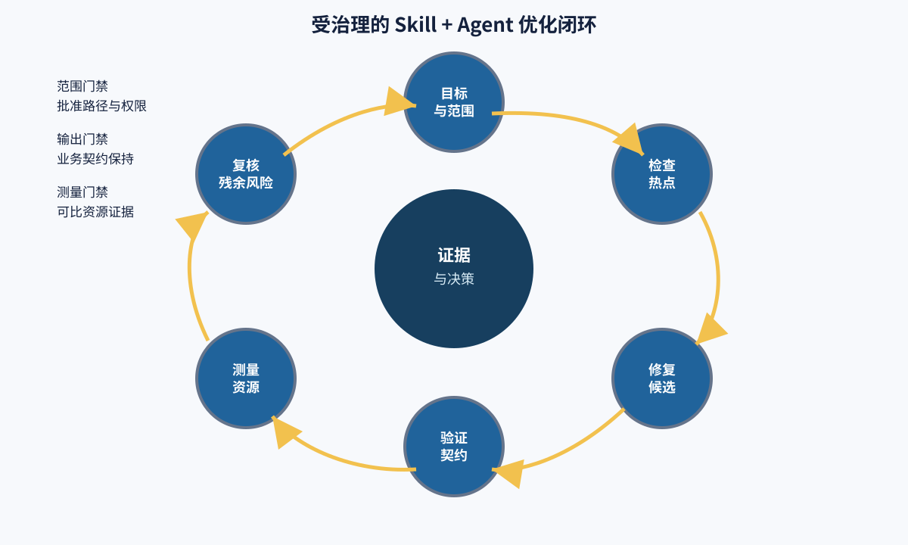
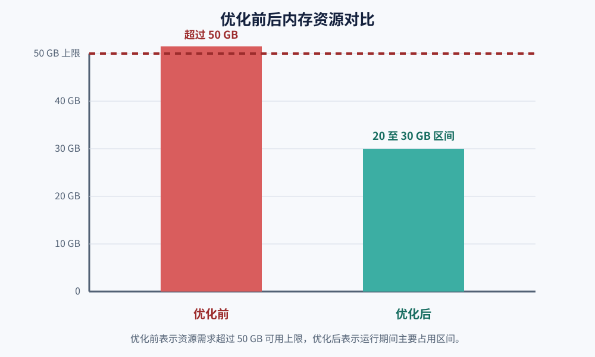
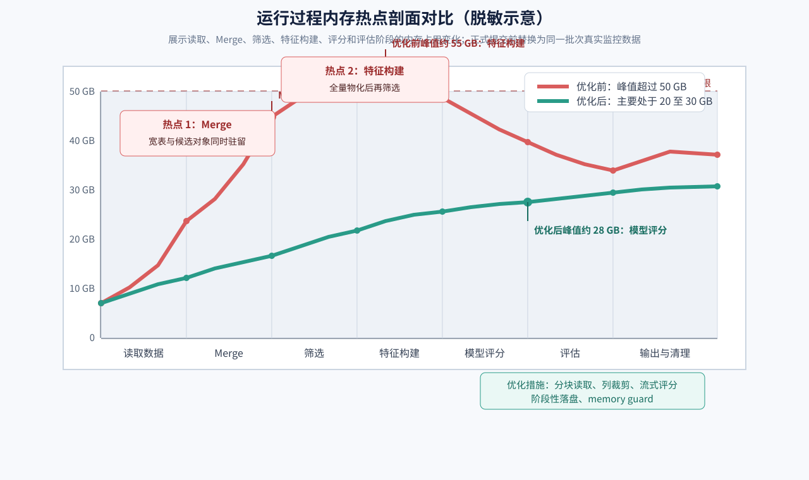

# 基于 Skill+Agent 的国产化系统智能资源优化技术及应用

> **企业内部技术创新奖申报材料（正式申报稿第二版）**  
> 文档属性：正式申报初稿 / 脱敏版  
> 申报方向：国产化改造、资源优化、工程智能化、降本增效

**关键词：** 国产化改造；Skill；Engineering Agent；内存热点；资源治理；流式处理；证据驱动

**摘要类型说明：** 本文采用小论文式结构组织申报内容。案例名称、业务字段和数据明细已脱敏；资源区间和工程措施按照现有项目记录整理，最终提交前应附运行监控和输出一致性证明。

**图表目录：** 图 1 总体技术架构；图 2 优化前后数据处理路径；图 3 受治理优化闭环；图 4 内存资源对比；图 5 工程资源模型；图 6 运行过程内存热点剖面对比。

## 摘要

在公司信息系统国产化改造和基础设施资源受限的背景下，部分大规模数据处理与模型评分任务面临内存峰值过高、运行不稳定、问题定位依赖少数专家等问题。传统处理方式通常依赖人工排查和一次性代码修改，难以形成可复用的优化经验，也缺少对修改范围、输出正确性和资源改善结果的完整验证。

本项目构建了基于 Skill+Agent 的智能资源优化技术体系。项目将内存热点识别、风险分级、修复策略、验证要求和复核方法沉淀为可复用的 Memory Skill；同时引入受治理的工程 Agent，对资源优化任务进行目标确认、范围控制、方案编排、候选修复、验证、测量和复核，形成 `check -> fix -> validate -> review -> stop/continue` 的有界闭环。

在某大规模客户经营分析与智能评分平台的脱敏应用案例中，面对千万级数据处理任务，原有流程在可用内存上限约 50 GB 的环境下出现峰值需求超过承载能力、任务 OOM 或中途中断的风险。经过两轮资源优化，数据读取、特征构建、候选生成、模型评分和评估链路逐步采用分块读取、row-group 处理、流式评分、阶段性中间产物和候选规模保护机制，运行期间内存占用主要稳定在约 20~30 GB 区间，主要处理流程能够稳定完成。在未扩大基础设施内存配置的条件下，系统恢复了约 20~30 GB 的运行余量，提升了国产化环境下大规模数据处理任务的资源适配能力和运行稳定性。

本项目的创新不在于单独引入某一个模型或参数，而在于将专家经验知识化、优化流程智能化、资源结果证据化，形成可迁移到其他国产化系统、数据处理任务和资源治理场景的工程能力。

## 1 引言：项目背景与现实需求

### 1.1 国产化改造带来的资源适配要求

国产化改造不仅是软件运行环境的替换，也会带来处理器架构、基础软件、中间件、数据引擎、驱动和资源配置策略的变化。原有系统在新环境下运行时，部分批处理任务的资源峰值可能被放大，原先依赖较大内存余量的实现方式不再适用。

在无法简单通过增加硬件资源解决问题的情况下，需要从数据读取边界、数据生命周期、中间对象管理、批次策略、模型推理和异常保护等方面进行系统性优化。资源优化不能只追求某一次任务的成功，还需要保证业务输出、数据契约和运行流程不被破坏。

### 1.2 原有工程痛点

大规模数据处理任务中的内存问题通常不是由单一语句造成，而是由多种模式叠加形成：

- 全量读取后再在内存中切块，形成“伪分块”；
- 宽表或候选矩阵过早生成，导致大量无关列和组合同时驻留；
- 多个中间对象在同一阶段长期并存，造成重复副本；
- 模型预测和评估阶段一次性加载过多数据；
- 资源保护阈值缺失，候选池膨胀后才发现机器已经无法承载；
- 优化经验停留在个人或单项目层面，无法快速迁移到其他系统；
- 修改完成后只关注任务是否跑通，缺少输出契约、资源数据和独立复核。

这些问题共同造成三个结果：资源使用率失控、故障排查周期较长、优化过程难以审计和复制。

## 2 总体技术方案

本项目采用“Skill 知识层 + Agent 执行治理层 + 业务处理层 + 证据验证层”的四层架构。



*图 1 总体技术架构。四层结构分别对应应用背景、业务处理对象、可复用知识与受治理执行，最终由证据和成效层形成闭环。*

### 2.1 Skill 知识层

Memory Skill 将内存优化专家经验拆分为四类能力：

1. `memory-check`：定位热点路径，识别全量物化、宽扫描、假分块、重复副本和高风险聚合等模式，并给出风险分级和修复优先级；
2. `memory-fix`：针对最高优先级热点生成行为保守、范围明确的候选修复方案；
3. `validation`：检查语法、测试、输出结构、关键字段和业务不变量；
4. `memory-review`：独立复核主热点是否下降、输出契约是否保持、峰值是否转移以及是否应继续下一轮。

Skill 的核心价值是将一次性专家经验变成可迁移的方法资产。不同系统只需增加项目级 Overlay 和验证命令，即可复用相同的基础诊断和治理方法。

### 2.2 Agent 执行与治理层

工程 Agent 不直接替代工程人员做无边界修改，而是在明确范围和权限内组织 Skill 执行：

- 将用户目标转化为明确的运行计划；
- 绑定目标路径、可执行命令、资源预算和预期产物；
- 将诊断结论、候选修复、验证结果和复核意见串联起来；
- 只允许在批准的边界内产生候选变更；
- 验证或复核失败时停止自动追加修改；
- 保留运行证据、残余风险和下一步建议。

工程人员保留方案审核、变更批准和最终发布权，形成“Agent 提效、人员决策、证据约束”的人机协同模式。

## 3 核心技术机制与形式化表达

### 3.1 峰值内存分解模型

将任务峰值内存分解为式（1）：

LaTeX 源码：

```latex
M_{peak}=M_{base}+M_{input}+M_{intermediate}+M_{model}+M_{concurrency}
```

$$
M_{peak}=M_{base}+M_{input}+M_{intermediate}+M_{model}+M_{concurrency}
\tag{1}
$$

其中：

- \(M_{base}\)：运行时和基础库占用；
- \(M_{input}\)：输入数据加载占用；
- \(M_{intermediate}\)：宽表、候选矩阵、临时副本和评估中间结果；
- \(M_{model}\)：模型、特征转换和推理缓存；
- \(M_{concurrency}\)：并发任务或多个工作进程产生的重复占用。

**表 1 优化措施与峰值内存分量的对应关系**

本项目的优化措施与模型项对应如下：

| 优化措施 | 主要降低的内存项 |
|---|---|
| customer chunk、按分区读取 | \(M_{input}\) |
| row-group 读取和读取边界列裁剪 | \(M_{input}\)、\(M_{intermediate}\) |
| 流式评分和分批预测 | \(M_{intermediate}\)、\(M_{concurrency}\) |
| 分阶段中间产物和及时释放对象 | \(M_{intermediate}\) |
| DuckDB 内存上限和候选规模保护 | 限制峰值继续膨胀 |

### 3.2 资源预算约束

对候选生成和批量评分阶段设置资源预算，得到式（2）：

LaTeX 源码：

```latex
M_{base}+M_{batch}+N_{candidate}\cdot\bar{m}_{row}
\leq M_{budget}-M_{reserve}
```

$$
M_{base}+M_{batch}+N_{candidate}\cdot\bar{m}_{row}
\leq M_{budget}-M_{reserve}
\tag{2}
$$

其中 \(N_{candidate}\) 为候选记录数量，\(\bar{m}_{row}\) 为单条候选记录的平均内存占用，\(M_{budget}\) 为机器资源预算，\(M_{reserve}\) 为系统运行和异常处理预留空间。

当约束可能被突破时，系统优先采取缩小批次、启用流式处理、阶段性落盘、控制候选池规模或安全停止等措施，而不是继续扩大内存驻留。

### 3.3 资源利用率与余量

以可用内存上限为基准，定义内存利用率和运行余量，分别对应式（3）和式（4）：

```latex
U_{memory}=\frac{M_{used}}{M_{limit}}
```

$$
U_{memory}=\frac{M_{used}}{M_{limit}}
\tag{3}
$$

案例中的优化前状态为：

```latex
M_{used}>50\text{ GB},\quad U_{memory}>100\%
```

优化后运行期间内存占用主要稳定在约 20~30 GB：

```latex
M_{used}\approx20\sim30\text{ GB},\quad
U_{memory}\approx40\%\sim60\%
```

对应的可用运行余量为：

```latex
M_{reserve}=M_{limit}-M_{used}\approx20\sim30\text{ GB}
```

$$
M_{reserve}=M_{limit}-M_{used}
\tag{4}
$$

上述各式的可视化排版见图 5；正文同时保留 LaTeX 源码，便于后续导入 Word、LaTeX 或 PPT 模板。



*图 5 工程资源模型。式（1）解释峰值来源，式（2）给出批次和候选规模的预算约束，式（3）和式（4）用于表达利用率和可恢复运行余量。*

该模型体现了本项目的核心策略：在不扩大机器内存配置的条件下，通过软件工程优化将任务从超载状态控制到可运行区间。

### 3.4 证据门禁

资源优化完成的判定不是“模型说已经完成”，而是至少满足以下条件：

```latex
\text{AcceptedOptimization}
=
\text{ScopeGate}\land
\text{OutputGate}\land
\text{ValidationGate}\land
\text{MeasurementGate}\land
\text{ReviewGate}
```

$$
\mathrm{AcceptedOptimization}
=\mathrm{ScopeGate}\land\mathrm{OutputGate}\land\mathrm{ValidationGate}
\land\mathrm{MeasurementGate}\land\mathrm{ReviewGate}
\tag{5}
$$

其中：

- `ScopeGate`：变更位于批准的目标和文件范围内；
- `OutputGate`：优化前后输出契约和关键业务不变量保持；
- `ValidationGate`：规定的测试、smoke 或有界验证通过；
- `MeasurementGate`：资源数据具有明确的测量方法和可比口径；
- `ReviewGate`：独立复核确认主热点下降或明确标注残余风险。

不满足任一条件时，系统只能输出“候选”“初步验证”或“需要人工复核”，不能直接形成资源改善结论。

## 4 典型应用与实施过程

### 4.1 应用对象

应用对象为某大规模客户经营分析与智能评分平台。该平台需要处理千万级数据，完成客户数据读取、标签构建、特征生成、候选关系计算、模型评分和效果评估等批处理任务。

为保护业务信息，申报材料对项目名称、数据字段、客户信息和具体业务规则进行脱敏，仅保留与技术创新和资源治理直接相关的处理特征。

### 4.2 优化前问题

原始链路存在以下资源风险：

- 数据读取边界较宽，部分数据在后续过滤前已进入内存；
- 候选关系和特征矩阵可能产生大规模中间对象；
- 名义上的分批处理发生在全量读取之后，实际仍然形成高峰；
- 评估和训练阶段存在多份中间结果同时驻留；
- 候选池扩大前缺少硬性资源保护，超过机器承载能力后才失败。

在可用内存上限约 50 GB 的环境中，千万级数据处理任务的真实峰值需求超过机器承载能力，出现 OOM 或中途中断风险，无法稳定完成完整流程。



*图 2 优化前后数据处理路径。优化重点从“全量物化后再处理”迁移到“在读取边界控制数据规模，并以流式方式推进后续阶段”。*

### 4.3 Skill + Agent 优化过程

第一阶段由 `memory-check` 对数据读取、特征构建、候选生成、评分和评估链路进行热点识别，输出热点路径、风险等级、修复顺序和验证缺口。

第二阶段由 `memory-fix` 根据优先级生成范围明确的候选修复，重点处理候选笛卡尔副本、特征矩阵副本、批预测预分配、评估 join、全量读取和分块边界等问题。

第三阶段将处理链路推进到 customer chunk 和 row-group 化处理，并通过流式评分避免全量候选矩阵长期驻留；同时增加分阶段中间产物，降低评估和训练阶段的中间峰值。

第四阶段增加候选行数保护、批次大小控制和底层数据引擎内存限制，在资源预算可能被突破时提前停止或降低处理粒度。

第五阶段由 validation 和 `memory-review` 复核完整 smoke pipeline、输出结构、关键处理契约和残余热点，确认优化没有演变成无关重构。



*图 3 受治理的优化闭环。每一轮均经过范围、输出和测量等门禁；未满足条件时停止并转入人工复核。*

### 4.4 实施结果

项目文档记录了两轮 memory optimization，并保持 smoke pipeline 全流程通过。优化后的链路采用 customer chunk、chunk/row-group 处理、流式评分和分阶段中间产物，运行期间内存占用主要稳定在约 20~30 GB 区间，主要处理流程能够稳定完成。

## 5 应用成效

### 5.1 资源成效



*图 4 内存资源对比。优化前柱体表示资源需求已超过 50 GB 可用上限；优化后柱体表示运行期间的主要占用区间，不将区间中值冒充为精确峰值。*



*图 6 运行过程内存热点剖面对比。红线表示优化前的脱敏示意曲线，绿色表示优化后的脱敏示意曲线；图中将 Merge 和特征构建阶段标记为重点热点位置。正式提交时应使用同一批次、同一机器口径下的真实监控导出图替换本示意图。*

**表 2 典型应用的资源成效对比**

| 指标 | 优化前 | 优化后 |
|---|---:|---:|
| 数据规模 | 千万级数据处理 | 千万级数据处理 |
| 可用内存上限 | 约 50 GB | 约 50 GB，未扩大 |
| 运行内存需求 | 峰值超过承载能力 | 主要稳定在约 20~30 GB |
| 内存利用率 | 超过 100%，存在 OOM 风险 | 约 40%~60% |
| 可用运行余量 | 不足 | 约 20~30 GB |
| 基础设施投入 | 需要考虑扩容或降载 | 在既有资源配置下运行 |

这里的 20~30 GB 是运行期间的主要内存占用区间；如后续补充完整监控曲线，可进一步将“主要稳定区间”细化为平均值、P95 或峰值指标。

### 5.2 稳定性成效

优化前，大数据量任务容易因为内存峰值超过承载能力而 OOM 或中途中断；优化后，主要处理流程能够稳定完成，资源峰值从不可控状态进入可管理区间。

### 5.3 工程效率成效

优化前，定位和修复主要依赖熟悉项目的少数人员；优化后，热点模式、修复优先级、验证要求和复核结论被沉淀为可复用的 Skill，Agent 能够对相似问题复用同一套流程，减少重复排查和经验传递成本。

### 5.4 管理与审计成效

每轮优化均可保留目标范围、变更候选、验证结果、资源测量、残余风险和停止原因，形成可复查的工程记录。该方式适合国产化改造中对变更可控、结果可追溯和责任边界清晰的要求。

## 6 项目创新点

### 创新点一：将资源优化专家经验沉淀为可迁移 Skill

项目将内存热点模式、数据生命周期分析、修复策略、验证方法和复核标准结构化，形成 `memory-check`、`memory-fix`、`memory-review` 和 `memory-optimizer-agent` 组合能力。相较于依赖个人经验的临时排查，Skill 可以跨项目复用，并通过项目 Overlay 适配不同业务链路。

### 创新点二：将资源优化过程工程化为受控 Agent 闭环

项目不是简单使用大模型生成代码，而是由 Agent 在明确目标、权限、预算、文件范围和停止条件下组织优化活动，将检查、修复、验证、复核串成可重复流程。工程人员仍保留审核和发布权，降低了智能化改造的越权和误修改风险。

### 创新点三：将资源改善结论建立在证据链上

项目把代码观察、热点发现、候选修复、输出验证、资源测量和独立复核分层记录，明确区分“结构上存在风险”“提出了修复方案”“任务通过验证”和“资源确实改善”。该机制避免把模型叙述或单次测试结果误当成性能结论。

### 创新点四：面向国产化资源约束建立低资源适配机制

项目通过读取边界优化、真实分块、流式评分、阶段性落盘、候选规模保护和底层内存限制，在不扩大基础设施资源的条件下提高任务运行稳定性，为国产化环境下大规模数据处理提供软件层面的资源适配方案。

## 7 推广价值与后续计划

本项目形成的能力不局限于单个客户经营分析平台，可推广到：

- 国产化数据仓库和批量数据加工任务；
- 特征工程和模型训练、推理任务；
- 大规模报表和数据评估流程；
- DuckDB、Parquet、CSV、Pandas、NumPy、Polars 等数据技术栈；
- 需要控制峰值内存、批次规模和中间对象生命周期的其他工程场景。

后续计划包括：

1. 建立更多国产化运行环境的资源基线和对照数据；
2. 将 CPU、磁盘、网络和并发资源纳入统一资源治理框架；
3. 扩大真实目标和代表性数据上的对照测量；
4. 完善跨项目 Skill 包、RulePack 和验证 Recipe；
5. 建立面向研发、测试和运维团队的复用流程。

## 8 结论

本项目针对国产化改造过程中的资源受限和系统稳定运行问题，形成了 Skill+Agent 相结合的智能资源优化技术体系。项目将内存优化知识资产化，将工程执行流程智能化，将资源改善结果证据化，并在千万级数据处理任务中验证了实际效果：在约 50 GB 内存上限未扩大的条件下，将原本容易超过机器承载能力的处理流程优化到主要使用约 20~30 GB 内存并稳定完成主要处理任务。

该项目体现了从“依靠硬件扩容解决资源问题”向“通过软件工程和智能化治理释放既有资源能力”的转变，具有明确的技术创新价值、国产化适配价值、降本增效价值和跨系统推广价值。

## 9 建议佐证材料清单

### 9.1 建议随申报提交的证据

1. 同一批次脱敏运行监控或资源曲线：按读取、Merge、筛选、特征构建、评分和评估阶段标注内存变化，证明优化前超过 50 GB、优化后主要稳定在 20~30 GB 区间；
2. 两轮 memory optimization 的变更记录和阶段说明；
3. smoke pipeline 全流程通过记录；
4. customer chunk、row-group、流式评分和 memory guard 的配置或代码截图；
5. Skill 组合包目录和 `check -> fix -> validate -> review` 流程图；
6. Agent 运行记录、验证结果和残余风险记录；
7. 优化前后输出契约或关键业务结果一致性证明；
8. 资源投入未扩大的说明或原有机器配置证明；
9. 后续可推广系统和预期复制场景清单。

### 9.2 现有内部材料对应关系

| 申报内容 | 现有材料 | 可支撑的结论 |
|---|---|---|
| 脱敏案例的高峰内存问题与优化区间 | Memory Skill Suite Wiki 的运行案例 | 原始资源上限约 50 GB、优化后主要处于约 20~30 GB 区间、主要流程稳定完成 |
| 两轮工程优化 | 客户经营分析平台 v0.3 进度记录 | customer chunk、chunk/row-group、阶段性中间产物和 smoke pipeline 全流程通过 |
| 流式和资源保护 | 客户经营分析平台生产配置说明 | 流式评分、批次控制、候选行数保护和底层内存限制 |
| Agent 的证据和安全边界 | Engineering Agent 运行记录与平台文档 | 受控运行、输出契约、目标完整性、测量状态和人工复核边界 |

### 9.3 提交前必须补齐的原始证据

当前文稿使用的是经过项目文档确认的量化区间。正式提交前，建议补齐同一批次的原始监控截图或导出数据，并至少包含采样时间、任务批次、机器内存上限、优化前后口径和输出一致性结果。补齐后可将“主要稳定在 20~30 GB 区间”进一步替换为平均值、P95 或峰值等更严格的统计指标。

## 10 口径说明

- “50 GB 以上”表示原始任务峰值需求超过约 50 GB 的可用内存上限，不表示已经精确测得一个固定峰值；
- “20~30 GB”表示优化后运行期间的主要内存占用区间，除非有完整峰值监控曲线，不建议改写为“峰值固定为 20~30 GB”；
- 申报材料中的实际应用成效来自脱敏客户经营分析类案例；`agent-dev` 中的小规模受控运行记录用于证明验证和审计机制，不作为生产规模资源下降的唯一依据；
- Agent 采用人机协同和候选修复模式，工程人员保留方案审核、批准和发布权；
- 资源改善结论应以可复查的监控、运行日志和前后对照记录为最终依据。
