# 基于 Skill+Agent 的国产化系统智能资源优化技术及应用

> **企业内部技术创新奖申报材料（第一次提交稿）**
>
> 文档属性：正式申报稿 / 脱敏版
>
> 申报方向：国产化改造、资源优化、工程智能化、降本增效

**关键词：** 国产化改造；Skill；Engineering Agent；峰值内存；资源约束；流式计算；证据驱动；工程智能化

**图表目录：** 图 1 Skill + Agent 整体架构与信息流向；图 2 项目创新机制三层模型；图 3 Memory Skill 五层知识体系与项目迁移结构；图 4 Agent 执行机制、控制边界与证据产物；图 5 工程资源模型汇总；图 6 峰值内存模型与资源预算的变量定义；图 7 证据门禁；图 8 优化前后数据处理路径；图 9 分阶段对象内存管理与峰值控制机制；图 10 受治理资源优化闭环；图 11 资源约束下的峰值控制效果；图 12 脱敏运行过程内存剖面对比；图 13 资源预算收敛与峰值控制机制；图 14 传统资源优化方式与 Skill + Agent 方法对比；图 15 资源优化结论的证据链与责任边界；图 16 Memory Skill 面向多类国产化任务的迁移方式。

## 摘要

在公司信息系统国产化改造和基础设施资源受限的背景下，部分大规模数据处理与模型评分任务面临内存峰值过高、运行不稳定、问题定位依赖少数专家等问题。传统处理方式通常依赖人工排查和一次性代码修改，难以形成可复用的优化经验，也缺少对修改范围、输出正确性和资源改善结果的完整验证。

本项目构建了基于 Skill+Agent 的智能资源优化技术体系。项目将内存热点识别、风险分级、修复策略、验证要求和复核方法沉淀为可复用的 Memory Skill；同时引入受治理的工程 Agent，对资源优化任务进行目标确认、范围控制、方案编排、候选修复、验证、测量和复核，形成 `check -> fix -> validate -> review -> stop/continue` 的有界闭环。

在某大规模客户经营分析与智能评分平台的脱敏应用案例中，面对千万级数据处理任务，原有流程因 Merge、Join、切片及多个中间对象叠加驻留，在可用内存上限约 50 GB 的环境下形成约 60 至 70 GB 的脱敏峰值需求区间，存在任务 OOM 或中途中断风险。经过两轮资源优化，数据读取、特征构建、候选生成、模型评分和评估链路逐步采用分块读取、row-group 处理、流式评分、阶段性中间产物和候选规模保护机制，运行期间内存占用主要稳定在约 20 至 30 GB 区间，主要处理流程能够稳定完成。在未扩大基础设施内存配置的条件下，系统恢复了约 20 至 30 GB 的运行余量，提升了国产化环境下大规模数据处理任务的资源适配能力和运行稳定性。

本项目的创新不在于单独引入某一个模型或参数，而在于将专家经验知识化、优化流程智能化、资源结果证据化，形成可迁移到其他国产化系统、数据处理任务和资源治理场景的工程能力。

## 1 引言：项目背景与现实需求

### 1.1 国产化改造带来的资源适配要求

国产化改造不仅是软件运行环境的替换，也会带来处理器架构、基础软件、中间件、数据引擎、驱动和资源配置策略的变化。原有系统在新环境下运行时，部分批处理任务的资源峰值可能被放大，原先依赖较大内存余量的实现方式不再适用。

在无法简单通过增加硬件资源解决问题的情况下，需要从数据读取边界、数据生命周期、中间对象管理、批次策略、模型推理和异常保护等方面进行系统性优化。资源优化不能只追求某一次任务的成功，还需要保证业务输出、数据契约和运行流程不被破坏。

### 1.2 原有工程痛点

大规模数据处理任务中的内存问题通常不是由单一语句造成，而是由多种模式叠加形成：

- 全量读取后再在内存中切块，形成“伪分块”；
- 宽表或候选矩阵过早生成，导致大量无关列和组合同时驻留；
- 多个中间对象在同一阶段长期并存，造成重复副本；
- 模型预测和评估阶段一次性加载过多数据；
- 资源保护阈值缺失，候选池膨胀后才发现机器已经无法承载；
- 优化经验停留在个人或单项目层面，无法快速迁移到其他系统；
- 修改完成后只关注任务是否跑通，缺少输出契约、资源数据和独立复核。

这些问题共同造成三个结果：资源使用率失控、故障排查周期较长、优化过程难以审计和复制。

### 1.3 研究问题与技术贡献

围绕上述工程约束，本文聚焦以下三个问题：其一，如何将跨项目可复用的内存热点知识表示为稳定的工程协议；其二，如何使 Agent 在不越过权限和变更边界的前提下组织诊断、修复与验证；其三，如何以可复查的测量和门禁规则区分“提出修复方案”“通过流程验证”和“确实改善资源峰值”这三类不同结论。

本文的技术贡献包括：

1. 提出由模式库、协议、Skill Core、项目 Overlay 和宿主适配组成的五层 Memory Skill 知识架构；
2. 构建以 `RunIntent`、`RunPlan` 和证据 Gate 为约束的 Skill+Agent 资源治理闭环；
3. 建立峰值内存分解模型与候选规模预算约束，将资源优化从经验性调参转化为可解释的工程控制问题；
4. 在脱敏的千万级数据处理任务中验证分块读取、row-group 处理、流式评分和中间产物分阶段管理对峰值控制的综合效果。

## 2 总体技术方案

本项目采用“Skill 知识层 + Agent 执行治理层 + 业务处理层 + 证据验证层”的四层架构。

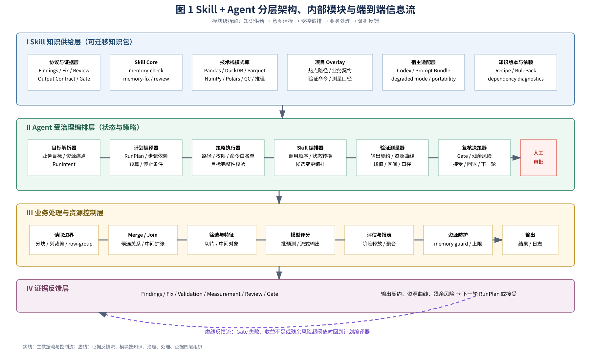

*图 1 Skill + Agent 整体架构与信息流向。图中细化展示 Skill 知识供给、Agent 受治理编排、业务处理与证据反馈四个层级，以及模块间的主执行流和迭代反馈流。*

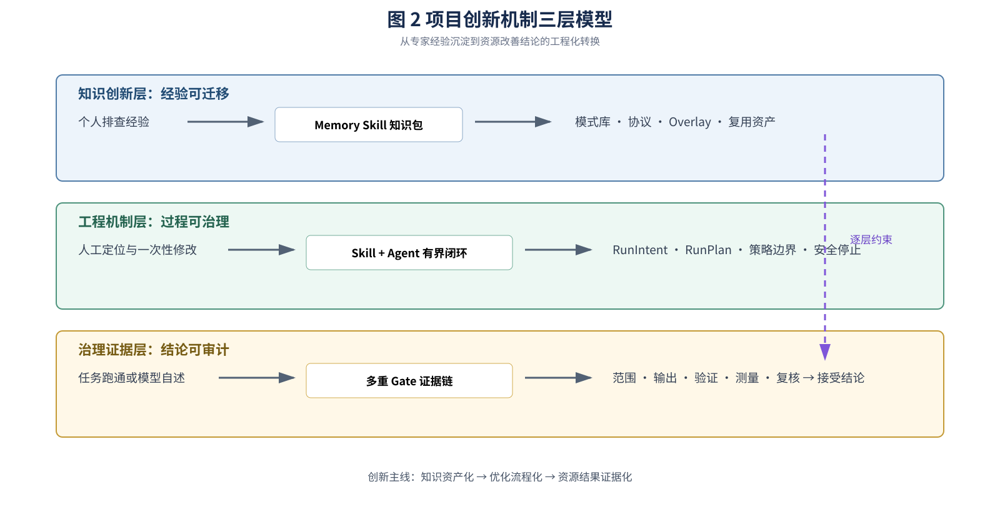

*图 2 项目创新机制三层模型。项目沿知识创新、工程机制和治理证据三个层面，将专家经验转化为可迁移、可执行、可审计的资源优化能力。*

### 2.1 Skill 知识层

Memory Skill 不是一组孤立提示词，而是由模式库、输出协议、技术栈适配、项目 Overlay 和宿主适配共同组成的知识层。它把“看代码找热点”提升为可迁移、可验证、可审计的工程方法。

#### 2.1.1 内存热点模式库

Skill 将跨项目反复出现的风险归纳为七类模式，并为每类模式绑定检测信号、修复策略和验证重点：

| 热点类别 | 典型表现                            | 主要风险                    | 对应策略                       |
| -------- | ----------------------------------- | --------------------------- | ------------------------------ |
| 读取物化 | 全量读取后再切块                    | 输入一次性进入内存          | 在读取边界分块并裁剪列         |
| 连接扩张 | Merge 或候选组合过早展开            | 中间矩阵指数式膨胀          | 先过滤、再分批连接             |
| 复制放大 | DataFrame、NumPy 数组和结果副本共存 | 多份大对象同时驻留          | 减少副本、明确对象生命周期     |
| 分块失效 | 名义分块，实际仍全量读取            | “假 chunking”无法降低峰值 | customer chunk、row-group 驱动 |
| 模型驻留 | 特征、模型输入、预测结果同时保留    | 推理阶段峰值升高            | 分批预测、流式评分、及时释放   |
| 峰值转移 | 前部热点下降后聚合或报表成为新热点  | 优化收益被下游抵消          | review 阶段继续追踪峰值        |
| 并发重复 | worker 重复加载数据或模型           | 并发数放大内存占用          | 设置有界并发和共享边界         |

#### 2.1.2 协议化输出

每个 Skill 入口均输出固定结构，便于 Agent 编排、人工复核和跨项目比较：

1. `memory-check`：定位热点路径，识别全量物化、宽扫描、假分块、重复副本和高风险聚合等模式，并给出风险分级和修复优先级；
2. `memory-fix`：针对最高优先级热点生成行为保守、范围明确的候选修复方案；
3. `validation`：检查语法、测试、输出结构、关键字段和业务不变量；
4. `memory-review`：独立复核主热点是否下降、输出契约是否保持、峰值是否转移以及是否应继续下一轮。

对应的结构化产物分别包括 `Findings / Fix / Review / Gate / Output Contract`，而不是只返回一段自然语言结论。

#### 2.1.3 五层知识架构

Skill 采用“协议与证据层—技术栈模式库层—Skill Core 层—项目 Overlay 层—宿主适配层”的五层结构。底层协议定义输入、输出和门禁；中间模式库沉淀 Pandas、DuckDB、Arrow/Parquet、CSV、NumPy、Polars、模型推理和 GC/cleanup 等技术栈经验；Skill Core 保持通用；项目 Overlay 承载仓库热点、业务契约和验证命令；宿主适配层支持 Codex、Prompt Bundle 等不同执行入口。

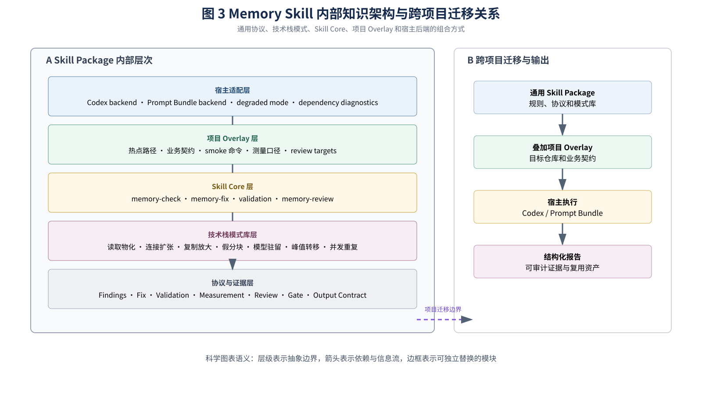

*图 3 Memory Skill 五层知识体系与项目迁移结构。图中拆解协议与证据、技术栈模式库、Skill Core、项目 Overlay 和宿主适配层，并展示通用 Skill Package 跨项目迁移为结构化证据资产的路径。*

#### 2.1.4 技术栈适配与项目 Overlay

同一热点在不同技术栈上的检测和修复方式不同。例如 Pandas 重点关注复制和索引，DuckDB 重点关注扫描列裁剪与内存上限，Parquet 重点关注 row-group，模型推理重点关注批预测和缓存。项目 Overlay 仅记录目标仓库的热点路径、字段契约、smoke 命令、测量口径和 review 关注点，避免把单项目规则污染到通用 Skill Core。

#### 2.1.5 宿主迁移与降级执行

Skill 可通过 `codex` backend 或 `prompt-bundle` backend 运行；当宿主能力、依赖或工具不可用时，进入 degraded mode，仍保留诊断、结构化输出和人工验证边界。validation portability 和 dependency diagnostics 使同一套知识能够迁移到国产化环境或受限执行节点。

Skill 的核心价值是将一次性专家经验变成可迁移的方法资产。不同系统只需增加项目级 Overlay 和验证命令，即可复用相同的基础诊断和治理方法。

### 2.2 Agent 执行与治理层

工程 Agent 不是简单的代码生成器，而是位于知识、执行和证据之间的受治理编排器。其核心任务是将不完备的业务目标转换为可执行、可停止、可审计的资源优化过程，并保证任何自动化动作均受目标范围、权限、资源预算和验证结果约束。

#### 2.2.1 从 RunIntent 到 RunPlan 的双层意图建模

`RunIntent` 描述“为什么优化”和“什么结果可以接受”，包括目标系统、主要资源问题、业务不变量、风险容忍度和人工审批要求；`RunPlan` 描述“如何执行”，将目标进一步分解为检查范围、Skill 调用顺序、允许修改的文件、验证命令、测量方法、资源预算和停止条件。两者分离后，业务意图不会被直接等同于可执行命令，计划也不能绕过原始目标和治理约束。

#### 2.2.2 有界 Skill 编排与状态推进

Agent 根据当前阶段和证据状态组织 `memory-check → memory-fix → validation → measurement → memory-review`。每一步均有明确输入、结构化输出和状态转换条件：诊断产生热点证据，修复只生成批准范围内的候选变更，验证检查业务契约，测量判断资源改善，复核决定停止、回退或进入下一轮。该机制将一次性对话转化为可重复的工程状态机。

#### 2.2.3 策略约束与安全停止

Agent 在执行前绑定目标完整性校验、文件范围、命令白名单、候选规模、内存预算和最大优化轮次。当验证失败、输出契约变化、测量口径不可比、目标文件漂移或连续优化收益不足时，Agent 停止自动追加修改并转入人工复核，避免优化过程演变为无边界重构或循环试错。

#### 2.2.4 证据驱动的结论生成

Agent 将“代码层风险”“候选修复”“验证通过”“测量改善”和“复核接受”作为不同状态记录。只有范围、输出、验证、测量和复核门禁同时满足时，才能形成正式资源改善结论；否则仅能输出候选结论、验证缺口或残余风险。这一机制使 Agent 的结论可追溯到具体运行记录，而不是依赖模型自述。

#### 2.2.5 人机协同与责任边界

工程人员保留方案审核、变更批准和最终发布权；Agent 负责知识检索、流程编排、候选生成、验证执行和证据汇总。二者形成“Agent 提效、人员决策、证据约束”的协同模式，使自动化能力能够进入对稳定性和审计要求较高的国产化改造场景。

**表 1 Agent 技术机制及其创新价值**

| 技术机制                 | Agent 产物                              | 创新价值                               |
| ------------------------ | --------------------------------------- | -------------------------------------- |
| RunIntent / RunPlan 分层 | 目标约束、执行计划、停止条件            | 防止业务目标未经治理直接转化为执行动作 |
| 有界 Skill 编排          | 阶段状态、调用顺序、结构化中间产物      | 将专家工具组合为可重复的工程状态机     |
| 策略与权限约束           | 文件范围、命令边界、资源预算、轮次上限  | 把安全边界前置到自动执行过程           |
| 证据门禁                 | 验证记录、测量状态、Gate 结果、残余风险 | 区分模型判断、流程通过和实际资源改善   |
| 人工审批                 | 候选变更、复核意见、发布决定            | 保留关键决策责任并支持审计追溯         |

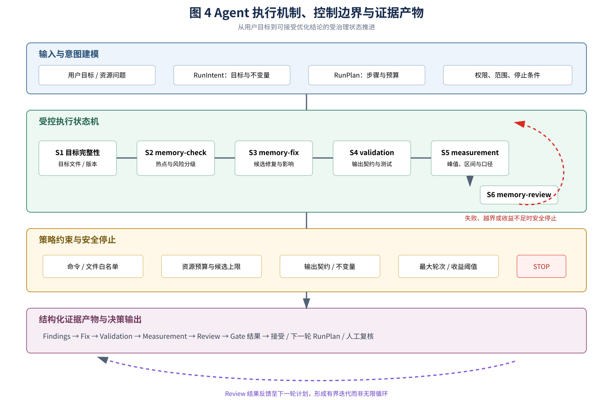

*图 4 Agent 执行机制、控制边界与证据产物。图中将 RunIntent/RunPlan 意图建模、六阶段状态推进、权限与资源边界、停止条件、证据产物及下一轮计划反馈统一表示。*

## 3 核心技术机制与形式化表达

### 3.1 峰值内存分解模型

将任务峰值内存分解为式（1）：

$$
\begin{aligned}
M_{\mathrm{peak}}={}&M_{\mathrm{base}}+M_{\mathrm{input}}
+M_{\mathrm{intermediate}} \\
&+M_{\mathrm{model}}+M_{\mathrm{concurrency}}
\end{aligned}
\tag{1}
$$

式中各变量的含义如下：

| 变量 | 含义 |
|---|---|
| $M_{\mathrm{base}}$ | 运行时和基础库占用 |
| $M_{\mathrm{input}}$ | 输入数据加载占用 |
| $M_{\mathrm{intermediate}}$ | 宽表、候选矩阵、临时副本和评估中间结果占用 |
| $M_{\mathrm{model}}$ | 模型、特征转换和推理缓存占用 |
| $M_{\mathrm{concurrency}}$ | 并发任务或多个工作进程产生的重复占用 |

*图 5 工程资源模型汇总。图中首先给出峰值内存分解，再给出资源预算、内存利用率和运行余量的形式化关系，为后续变量解释和资源控制提供统一模型。*

**表 2 优化措施与峰值内存分量的对应关系**

本项目的优化措施与模型项对应如下：

| 优化措施                       | 主要降低的内存项                      |
| ------------------------------ | ------------------------------------- |
| customer chunk、按分区读取     | $M_{\mathrm{input}}$ |
| row-group 读取和读取边界列裁剪 | $M_{\mathrm{input}}$、$M_{\mathrm{intermediate}}$ |
| 流式评分和分批预测             | $M_{\mathrm{intermediate}}$、$M_{\mathrm{concurrency}}$ |
| 分阶段中间产物和及时释放对象   | $M_{\mathrm{intermediate}}$ |
| DuckDB 内存上限和候选规模保护  | 限制峰值继续膨胀                      |

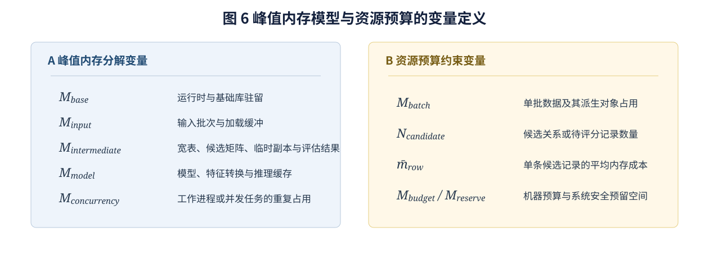

*图 6 峰值内存模型与资源预算的变量定义。图中明确连接峰值分量、批次预算与可控制的对象规模。*

### 3.2 资源预算约束

对候选生成和批量评分阶段设置资源预算，得到式（2）：

$$
\begin{aligned}
M_{\mathrm{base}}+M_{\mathrm{batch}}
+N_{\mathrm{candidate}}\cdot\bar{m}_{\mathrm{row}}
&\leq M_{\mathrm{budget}}-M_{\mathrm{reserve}}
\end{aligned}
\tag{2}
$$

其中，$N_{\mathrm{candidate}}$ 为候选记录数量，$\bar{m}_{\mathrm{row}}$ 为单条候选记录的平均内存占用，$M_{\mathrm{budget}}$ 为机器资源预算，$M_{\mathrm{reserve}}$ 为系统运行和异常处理预留空间。

当约束可能被突破时，系统优先采取缩小批次、启用流式处理、阶段性落盘、控制候选池规模或安全停止等措施，而不是继续扩大内存驻留。

### 3.3 资源利用率与余量

以可用内存上限为基准，定义内存利用率和运行余量，分别对应式（3）和式（4）：

$$
U_{\mathrm{memory}}
=\frac{M_{\mathrm{used}}}{M_{\mathrm{limit}}}
\tag{3}
$$

在约 50 GB 的资源上限下，优化前的脱敏峰值需求区间可表示为：

$$
M_{\mathrm{required}}\approx60\sim70\ \mathrm{GB},\qquad
U_{\mathrm{required}}
=\frac{M_{\mathrm{required}}}{M_{\mathrm{limit}}}
\approx120\%\sim140\%
$$

优化后运行期间内存占用主要稳定在约 20 至 30 GB：

$$
M_{\mathrm{used}}\approx20\sim30\ \mathrm{GB},\qquad
U_{\mathrm{memory}}\approx40\%\sim60\%
$$

对应的可用运行余量为：

$$
M_{\mathrm{reserve}}
=M_{\mathrm{limit}}-M_{\mathrm{used}}
\approx20\sim30\ \mathrm{GB}
\tag{4}
$$

该模型体现了本项目的核心策略：在不扩大机器内存配置的条件下，通过软件工程优化将任务从超载状态控制到可运行区间。

### 3.4 证据门禁

资源优化完成的判定不是“模型说已经完成”，而是至少满足以下条件：

$$
\begin{aligned}
\mathrm{AcceptedOptimization}={}&
\mathrm{ScopeGate}\land\mathrm{OutputGate}\land\mathrm{ValidationGate} \\
&\land\mathrm{MeasurementGate}\land\mathrm{ReviewGate}
\end{aligned}
\tag{5}
$$

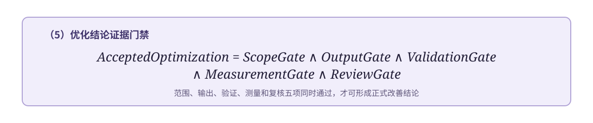

*图 7 证据门禁公式。只有范围、输出、验证、测量和复核条件同时满足，优化结果才可被接受。*

其中：

- `ScopeGate`：变更位于批准的目标和文件范围内；
- `OutputGate`：优化前后输出契约和关键业务不变量保持；
- `ValidationGate`：规定的测试、smoke 或有界验证通过；
- `MeasurementGate`：资源数据具有明确的测量方法和可比口径；
- `ReviewGate`：独立复核确认主热点下降或明确标注残余风险。

不满足任一条件时，系统只能输出“候选”“初步验证”或“需要人工复核”，不能直接形成资源改善结论。

## 4 应用场景与实验性验证

### 4.1 应用对象

应用对象为某大规模客户经营分析与智能评分平台。该平台需要处理千万级数据，完成客户数据读取、标签构建、特征生成、候选关系计算、模型评分和效果评估等批处理任务。

为保护业务信息，申报材料对项目名称、数据字段、客户信息和具体业务规则进行脱敏，仅保留与技术创新和资源治理直接相关的处理特征。

### 4.2 优化前问题

原始链路存在以下资源风险：

- 数据读取边界较宽，部分数据在后续过滤前已进入内存；
- 候选关系和特征矩阵可能产生大规模中间对象；
- 名义上的分批处理发生在全量读取之后，实际仍然形成高峰；
- 评估和训练阶段存在多份中间结果同时驻留；
- 候选池扩大前缺少硬性资源保护，超过机器承载能力后才失败。

在可用内存上限约 50 GB 的环境中，Merge、Join、切片和中间对象同时驻留使任务形成约 60 至 70 GB 的脱敏峰值需求区间，超过机器承载能力，出现 OOM 或中途中断风险，无法稳定完成完整流程。

*图 8 优化前后数据处理路径。优化重点从“全量物化后再处理”迁移到“在读取边界控制数据规模，并以流式方式推进后续阶段”。*

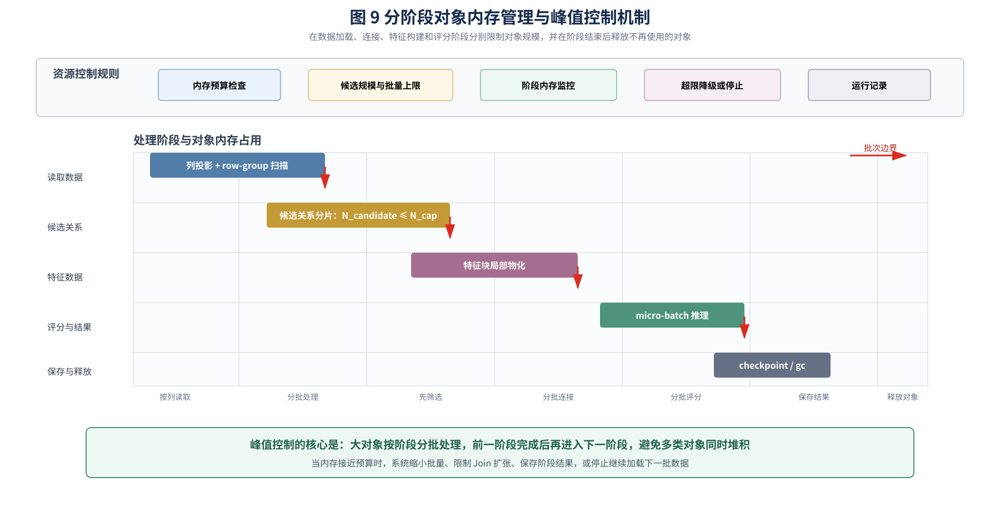

*图 9 分阶段对象内存管理与峰值控制机制。图中展示按列读取、分批处理、分批连接、分批评分、阶段保存与释放等方法，如何避免读取、候选、特征和评分结果同时大量堆积。*

### 4.3 Skill + Agent 优化过程

为保证前后结果具有可比性，验证设计遵循“同一数据批次、同一机器资源上限、同一输出契约、同一测量口径”的原则。优化前后分别记录阶段级内存曲线、任务完成状态、输出结构和关键业务不变量；资源结果以运行期间主要占用区间和可观测峰值共同描述，不以单一示意点替代原始监控证据。

第一阶段由 `memory-check` 对数据读取、特征构建、候选生成、评分和评估链路进行热点识别，输出热点路径、风险等级、修复顺序和验证缺口。

第二阶段由 `memory-fix` 根据优先级生成范围明确的候选修复，重点处理候选笛卡尔副本、特征矩阵副本、批预测预分配、评估 join、全量读取和分块边界等问题。

第三阶段将处理链路推进到 customer chunk 和 row-group 化处理，并通过流式评分避免全量候选矩阵长期驻留；同时增加分阶段中间产物，降低评估和训练阶段的中间峰值。

第四阶段增加候选行数保护、批次大小控制和底层数据引擎内存限制，在资源预算可能被突破时提前停止或降低处理粒度。

第五阶段由 validation 和 `memory-review` 复核完整 smoke pipeline、输出结构、关键处理契约和残余热点，确认优化没有演变成无关重构。

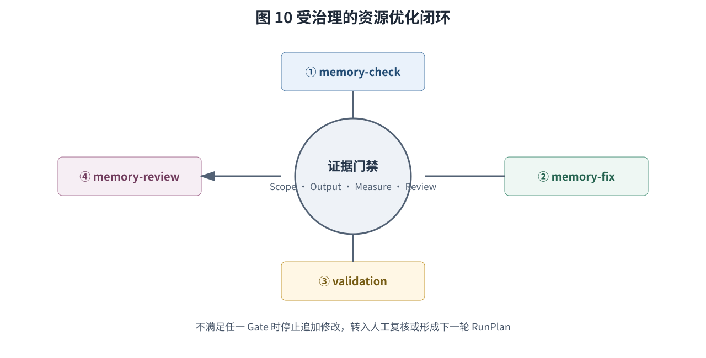

*图 10 受治理的优化闭环。每一轮均经过范围、输出和测量等门禁；未满足条件时停止并转入人工复核。*

### 4.4 实施结果

项目文档记录了两轮 memory optimization，并保持 smoke pipeline 全流程通过。优化后的链路采用 customer chunk、chunk/row-group 处理、流式评分和分阶段中间产物，运行期间内存占用主要稳定在约 20 至 30 GB 区间，主要处理流程能够稳定完成。

## 5 结果与讨论

### 5.1 资源成效

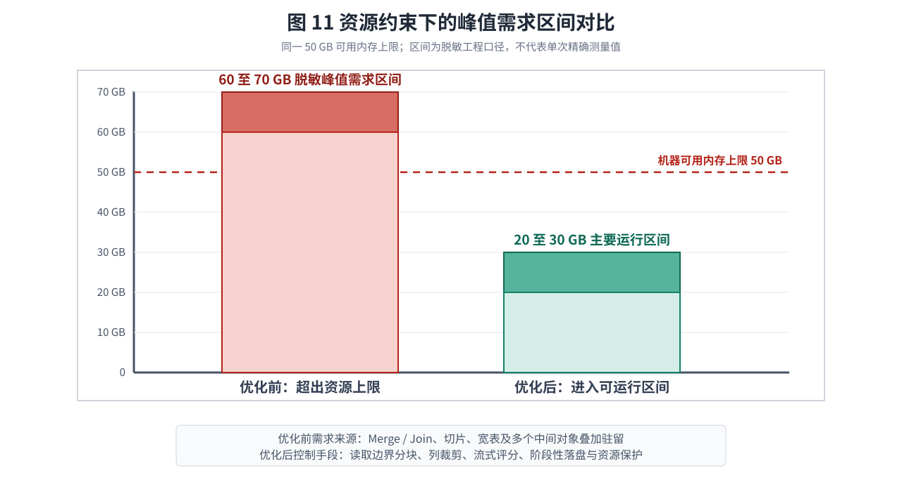

*图 11 内存资源对比。优化前柱体表示由 Merge、Join、切片和中间对象叠加造成的脱敏峰值需求区间约为 60 至 70 GB，超过 50 GB 可用上限；优化后柱体表示运行期间的主要占用区间，不将区间中值冒充为精确峰值。*

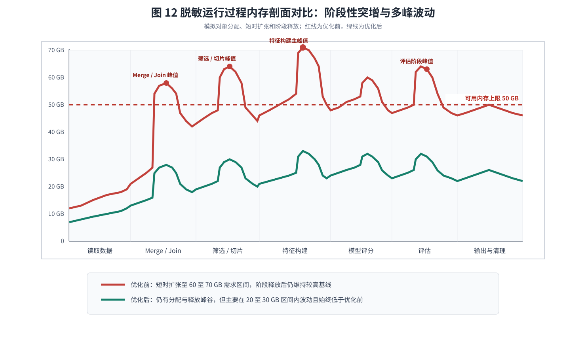

*图 12 运行过程内存热点剖面对比。红线表示优化前的阶段级脱敏模拟曲线，呈现 Merge、筛选、特征构建和评估阶段的短时突增与回落；绿色表示优化后的脱敏曲线，仍保留峰谷波动但整体低于红线。*

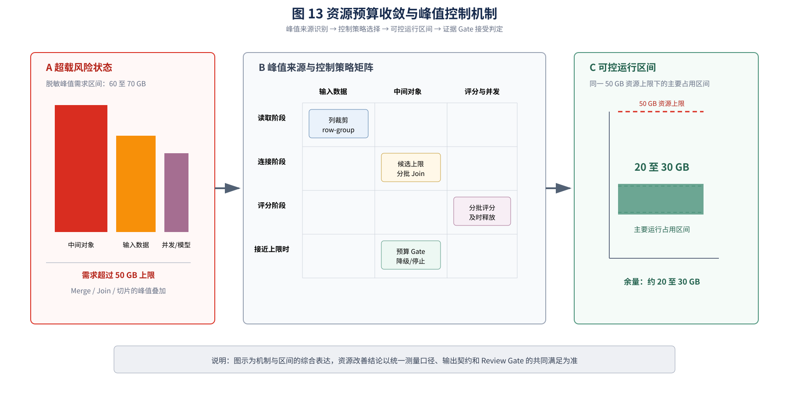

*图 13 资源预算收敛与峰值控制机制。图中以峰值分量、控制策略矩阵、可控运行区间和 Gate 判据表达综合控制路径；不将单项机制表述为独立消融测得的精确降幅。*

**表 3 典型应用的资源成效对比**

| 指标         |                                   优化前 |                   优化后 |
| ------------ | ---------------------------------------: | -----------------------: |
| 数据规模     |                           千万级数据处理 |           千万级数据处理 |
| 可用内存上限 |                                 约 50 GB |         约 50 GB，未扩大 |
| 运行内存需求 | 脱敏峰值需求约 60 至 70 GB，超过承载能力 | 主要稳定在约 20 至 30 GB |
| 内存利用率   |                 超过 100%，存在 OOM 风险 |            约 40% 至 60% |
| 可用运行余量 |                                     不足 |           约 20 至 30 GB |
| 基础设施投入 |                       需要考虑扩容或降载 |     在既有资源配置下运行 |

这里的 20 至 30 GB 是运行期间的主要内存占用区间，并非对所有采样时刻或所有批次的精确峰值估计。

### 5.2 稳定性成效

优化前，大数据量任务容易因 Merge、Join、切片和中间对象叠加形成约 60 至 70 GB 的脱敏峰值需求，超过可用内存上限并发生 OOM 或中途中断；优化后，各阶段仍存在正常的峰谷波动，但主要占用被控制在约 20 至 30 GB，处理流程进入可管理区间。

### 5.3 工程效率成效

优化前，定位和修复主要依赖熟悉项目的少数人员；优化后，热点模式、修复优先级、验证要求和复核结论被沉淀为可复用的 Skill，Agent 能够对相似问题复用同一套流程，减少重复排查和经验传递成本。

### 5.4 管理与审计成效

每轮优化均可保留目标范围、变更候选、验证结果、资源测量、残余风险和停止原因，形成可复查的工程记录。该方式适合国产化改造中对变更可控、结果可追溯和责任边界清晰的要求。

## 6 技术创新与工程意义

### 6.1 将资源优化专家经验沉淀为可迁移 Skill

项目将内存热点模式、数据生命周期分析、修复策略、验证方法和复核标准结构化，形成 `memory-check`、`memory-fix`、`memory-review` 和 `memory-optimizer-agent` 组合能力。相较于依赖个人经验的临时排查，Skill 可以跨项目复用，并通过项目 Overlay 适配不同业务链路。

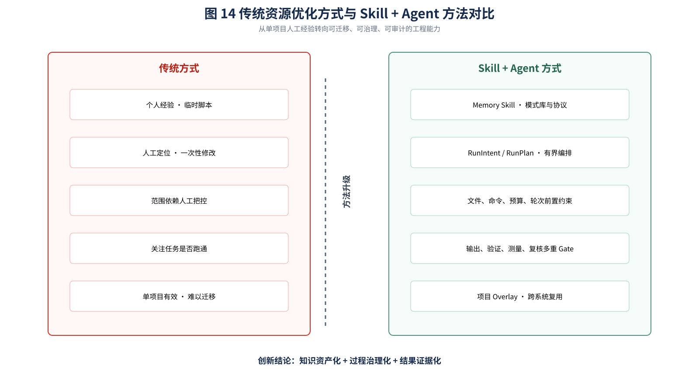

*图 14 传统资源优化方式与 Skill + Agent 方法对比。对比突出知识载体、执行方式、控制边界、验证标准和跨项目复用能力的系统升级。*

### 6.2 将资源优化过程工程化为受控 Agent 闭环

项目不是简单使用大模型生成代码，而是由 Agent 在明确目标、权限、预算、文件范围和停止条件下组织优化活动，将检查、修复、验证、复核串成可重复流程。工程人员仍保留审核和发布权，降低了智能化改造的越权和误修改风险。

### 6.3 将资源改善结论建立在证据链上

项目把代码观察、热点发现、候选修复、输出验证、资源测量和独立复核分层记录，明确区分“结构上存在风险”“提出了修复方案”“任务通过验证”和“资源确实改善”。该机制避免把模型叙述或单次测试结果误当成性能结论。

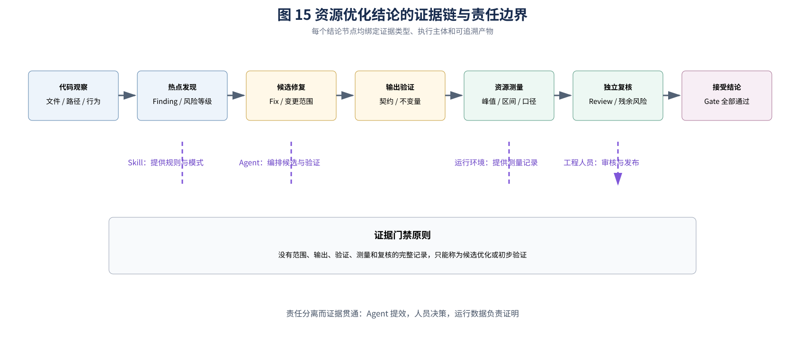

*图 15 资源优化结论的证据链与责任边界。Skill 提供规则，Agent 组织执行，运行环境提供测量，工程人员保留审核与发布责任。*

### 6.4 面向国产化资源约束建立低资源适配机制

项目通过读取边界优化、真实分块、流式评分、阶段性落盘、候选规模保护和底层内存限制，在不扩大基础设施资源的条件下提高任务运行稳定性，为国产化环境下大规模数据处理提供软件层面的资源适配方案。

### 6.5 适用边界与证据限制

本文所述 60 至 70 GB，是基于 Merge、Join、切片和中间对象叠加行为归纳出的脱敏峰值需求区间；20 至 30 GB 是优化后运行期间的主要占用区间。二者均用于描述资源变化范围，不等同于所有批次的精确统计峰值。图 12 按照已知阶段行为绘制脱敏模拟曲线，用于说明热点分布、短时突增和优化前后的相对变化关系。

## 7 推广价值与后续计划

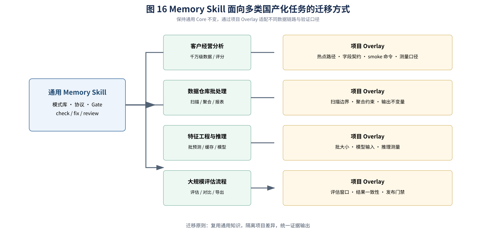

*图 16 Memory Skill 面向多类国产化任务的迁移方式。通过项目 Overlay 隔离不同业务链路的热点路径、字段契约、验证命令和测量口径，同时复用通用 Skill Core。*

本项目形成的能力不局限于单个客户经营分析平台，可推广到：

- 国产化数据仓库和批量数据加工任务；
- 特征工程和模型训练、推理任务；
- 大规模报表和数据评估流程；
- DuckDB、Parquet、CSV、Pandas、NumPy、Polars 等数据技术栈；
- 需要控制峰值内存、批次规模和中间对象生命周期的其他工程场景。

后续计划包括：

1. 建立更多国产化运行环境的资源基线和对照数据；
2. 将 CPU、磁盘、网络和并发资源纳入统一资源治理框架；
3. 扩大真实目标和代表性数据上的对照测量；
4. 完善跨项目 Skill 包、RulePack 和验证 Recipe；
5. 建立面向研发、测试和运维团队的复用流程。

## 8 结论

本项目针对国产化改造过程中的资源受限和系统稳定运行问题，形成了 Skill+Agent 相结合的智能资源优化技术体系。项目将内存优化知识资产化，将工程执行流程智能化，将资源改善结果证据化，并在千万级数据处理任务中验证了实际效果：在约 50 GB 内存上限未扩大的条件下，将原本容易超过机器承载能力的处理流程优化到主要使用约 20 至 30 GB 内存并稳定完成主要处理任务。

该项目体现了从“依靠硬件扩容解决资源问题”向“通过软件工程和智能化治理释放既有资源能力”的转变，具有明确的技术创新价值、国产化适配价值、降本增效价值和跨系统推广价值。
